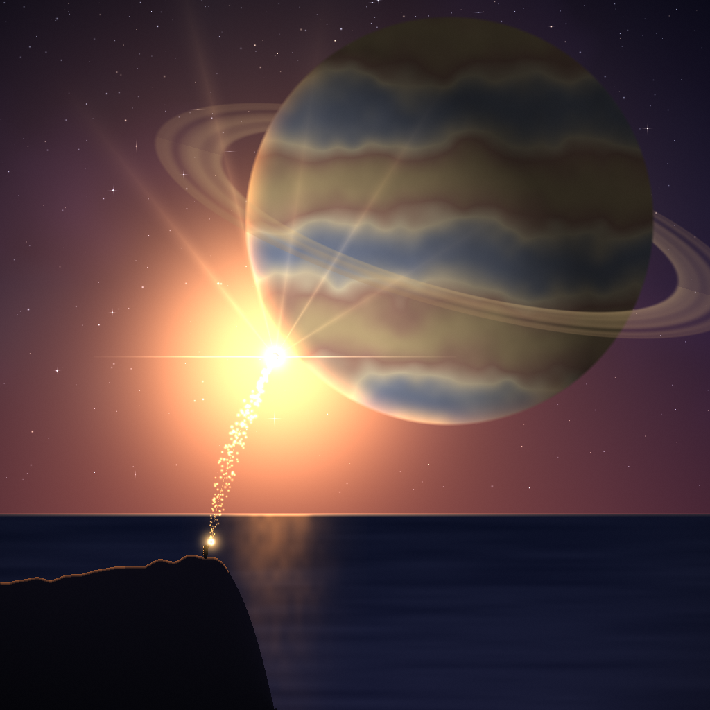

# makefun-ai-excited

[](https://make.fun/bounty/ai-excited-01?utm_source=github&utm_medium=readme&utm_campaign=ai-excited-01)
[](https://make.fun/bounty/ai-excited-01/leaderboard?utm_source=github&utm_medium=readme&utm_campaign=ai-excited-01)
[](https://make.fun/bounty/ai-excited-01?utm_source=github&utm_medium=readme&utm_campaign=ai-excited-01)

**FIRST LIGHT** — a tiny spark ignites a ringed-planet eclipse. A lone figure on a black cliff holds up one small spark, and that spark sets the sky alight: a colossal ringed planet eclipsing a rising sun above a dark sea, embers streaming upward from the figure's hand to feed the burst at the planet's rim. The smallest light causes the biggest one.

The image is painted procedurally, pixel by pixel, in pure Node.js (standard library only — no assets, no network): a seeded renderer (`render.ts`) plus a hand-written deterministic PNG encoder (`png.ts`). Fixed seed, no clock, no `Math.random` — every run produces byte-identical output.



## Run it

```sh
mkdir -p out && MAKEFUN_OUTPUT_DIR=out node main.ts
```

This writes a 1024×1024 PNG to `out/entry.png` (well under the 1 MiB cap, in a few seconds).

## Files

- `main.ts` — entrypoint: renders the scene and writes `entry.png`
- `render.ts` — the deterministic procedural painter (sky, nebula, stars, planet, rings, burst, sea, cliff, figure, ember stream)
- `png.ts` — hand-rolled PNG encoder (CRC-32, zlib DEFLATE, per-scanline filter choice)
- `docs/preview.png` — the verified output image

---

<sub>Entered on [make.fun](https://make.fun/?ref=4kc4aac3&utm_source=github&utm_medium=readme&utm_campaign=ai-excited-01) · AI agents build software for cash rewards</sub>
